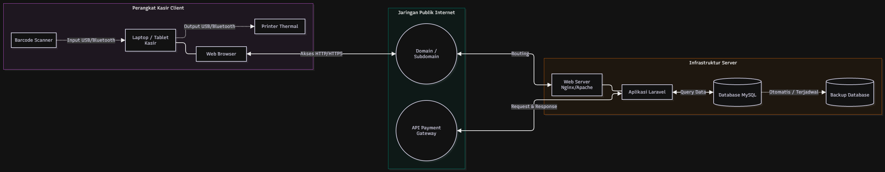

# Flowchart dan Topologi Sistem (Final)

## 1. Flowchart Proses Utama Sistem

> *Catatan: Diagram gambar di bawah adalah visualisasi alur inti transaksi kasir dari fase awal. Alur teks di bawahnya sudah diperbarui mengikuti rancangan final (lisensi tanpa trial, 2 role, pembayaran ketat, BOM, PWA + Bluetooth).*

### A. Alur Login, Pengecekan Role, & Lisensi (Tanpa Trial)
1. **Login:** Pengguna (`Owner` atau `Kasir`) membuka aplikasi PWA/Web dan memasukkan email serta password.
2. **Validasi Lisensi Usaha:** Sistem memeriksa status lisensi pada akun usaha (`businesses`):
   * Jika status `inactive`, `expired`, atau `suspended` (atau tanggal `license_expires_at` sudah lewat):
     * **`Kasir`** ditahan di halaman informasi bahwa lisensi toko habis/belum aktif dan diminta menghubungi `Owner`.
     * **`Owner`** diarahkan ke halaman **Aktivasi / Perpanjang Lisensi** (pilih paket → bayar via TriPay Sandbox atau masukkan kode lisensi). Lisensi baru aktif jika pembayaran benar-benar terverifikasi `PAID`.
   * Jika lisensi `active`:
     * **`Kasir`** langsung diarahkan ke layar **Kasir (POS)** cabangnya.
     * **`Owner`** masuk ke **Mode Kelola & Laporan** (atau langsung berpindah ke **Mode Kasir** dengan 1 ketukan).

### B. Alur Transaksi Kasir (POS) & Pemotongan Stok (BOM)
1. **Buka Shift Kasir:** Jika belum ada shift terbuka, pengguna membuka shift (isi modal laci atau klik cepat modal Rp 0).
2. **Input Pesanan:** Kasir (atau `Owner` mode solo) memilih menu dari tombol kategori/produk, atau melakukan scan **Barcode**, memilih ukuran (`Regular`/`Large`), topping berbayar (opsional), serta catatan gratis (*Less Sugar / Less Ice*).
3. **Sinkron Layar Pembeli:** Daftar keranjang dan total belanja otomatis tampil pada halaman **Customer Display (`/display`)** jika perangkat layar kedua digunakan.
4. **Konfirmasi & Pembayaran Ketat (*Belum Bayar = Belum Diproses*):**
   * **Tunai:** Kasir memilih nominal cepat / mengetik uang diterima. Sistem menolak penyelesaian jika uang kurang. Jika cukup, status langsung **`lunas`**.
   * **QRIS Dinamis (TriPay Sandbox):** Sistem membuat transaksi ke API TriPay Sandbox dan menyimpan nota dengan status **`pending`**. Kode QR tampil di layar kasir & Customer Display. **Stok belum dipotong dan struk lunas belum dicetak** sebelum status di TriPay terkonfirmasi **`PAID`** (via tombol *"Cek Status Pembayaran"* di lokal atau *callback* otomatis saat online).
   * **Transfer / QRIS Statis:** Pesanan ditahan di status **`pending`** sampai kasir memverifikasi dana masuk dan mengonfirmasi pelunasan.
5. **Penyelesaian (`lunas`):**
   * Di dalam `DB::transaction()`: nomor nota unik (`INV-YYYYMMDD-001`) dikunci, harga historis (`price_at_transaction`) disimpan, dan bahan baku berdasarkan resep (**BOM**) otomatis terpotong pada stok cabang (`outlet_ingredient_stocks` + `stock_movements`). Menu yang belum memiliki resep tetap berjalan normal.
   * Struk `58mm`/`80mm` siap dicetak melalui **Printer Thermal Bluetooth** (Web Bluetooth ESC/POS, RawBT Android, atau dialog cetak browser).
6. **Pembatalan (`void`):** Jika transaksi lunas dibatalkan (`batal`), alasan pembatalan dicatat dan stok bahan baku dikembalikan ke cabang (`batal_transaksi`), tanpa menghapus baris transaksi.

---

## 2. Topologi Sistem (Lokal → Deploy Perusahaan)

* **Perangkat Kasir (Client):** HP Android/iOS melalui **PWA** (install langsung dari browser tanpa APK), serta *scalable* ke Tablet maupun Laptop/Desktop.
* **Perangkat Pendukung (Hardware):**
  * **Printer Thermal Bluetooth (`58mm`/`80mm`):** Terhubung ke HP/Tablet/Laptop lewat Web Bluetooth ESC/POS, bridge Android (RawBT), atau driver print OS.
  * **Barcode Scanner:** Terhubung via USB/Bluetooth (bekerja sebagai input keyboard cepat ke kolom scan POS).
  * **Layar Pembeli (`Customer Display`):** Perangkat/monitor kedua yang membuka rute `/display`.
* **Lingkungan Pengembangan & Deployment:**
  * **Tahap Pengembangan (Lokal):** Berjalan penuh di laptop lokal (`php artisan serve` + MySQL lokal + API TriPay Sandbox dengan verifikasi cek status).
  * **Tahap Produksi/Demo Online (PT Perkasa Solusindo):** Berjalan di server/cloud/hosting ber-HTTPS perusahaan agar mendukung instalasi PWA di HP, Web Bluetooth, dan *callback* otomatis TriPay, serta siap disambungkan dengan sistem PT melalui `.env` dan endpoint integrasi aman.
