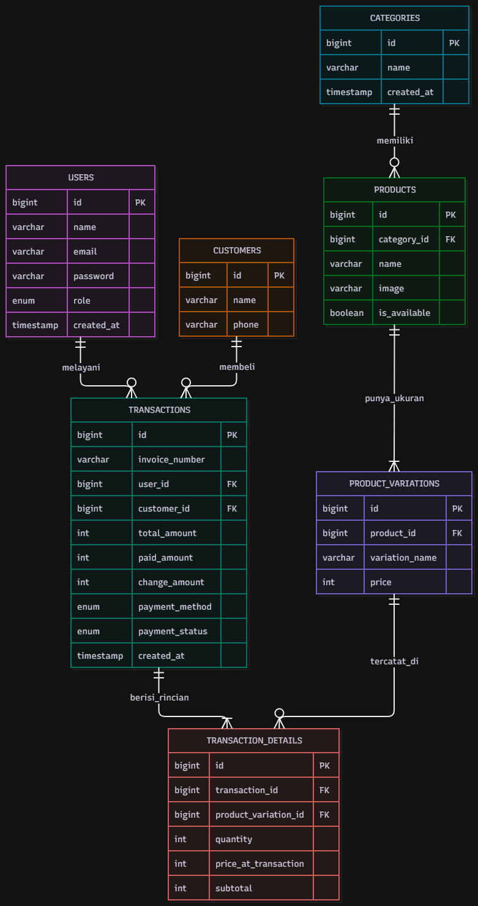

Rancangan Database Sistem Kasir
1. Gambaran Umum Database
Bayangkan database ini seperti lemari arsip di gerai es teh. Supaya catatannya tidak berantakan, kita membagi arsip menjadi dua bagian:

Data Master (Data Pokok): Data yang jarang berubah, seperti daftar akun pegawai, kategori minuman, daftar menu, dan harganya.

Data Transaksi (Data Harian): Data yang terus bertambah setiap kali ada pembeli, yaitu struk belanja dan rincian minuman yang dibeli.

Di rancangan ini, nama minuman dan ukurannya dipisah tabelnya. Alasannya karena satu menu (misalnya Es Teh Leci) punya ukuran Regular dan Large yang harganya berbeda. Selain itu, harga saat pembeli bertransaksi juga ikut disimpan di tabel detail transaksi. Tujuannya, kalau bulan depan pemilik usaha menaikkan harga es teh, catatan total uang di struk bulan lalu tidak ikut berubah.

2. Daftar Tabel
Untuk tahap awal (MVP) agar aplikasi kasir bisa langsung dipakai jualan sehari-hari, kita cukup membuat 7 tabel utama:

users: Menyimpan akun untuk login (owner, admin, dan kasir).

categories: Menyimpan kelompok menu (contoh: Original Tea, Milk Tea, Fruit Tea).

products: Menyimpan nama menu minumannya saja (contoh: Es Teh Original, Es Teh Leci).

product_variations: Menyimpan pilihan ukuran cup (Regular, Large) beserta harganya.

customers: Menyimpan nama dan nomor HP pembeli (jika diperlukan).

transactions: Menyimpan data kepala struk (nomor nota, total bayar, cara bayar, dan kembalian).

transaction_details: Menyimpan daftar minuman apa saja yang dibeli di dalam satu struk.

3. Struktur Kolom Setiap Tabel
Info tambahan untuk Laravel: Saat kita membuat tabel di Laravel, biasanya otomatis dibuatkan kolom created_at dan updated_at (TIMESTAMP) untuk mencatat waktu data dibuat dan diubah.

1. Tabel users
Tempat menyimpan data orang yang bisa login ke sistem kasir.

##id##
Tipe Data: BIGINT
Kunci: Primary Key
Status: Wajib diisi
Fungsi: Nomor identitas unik tiap akun (otomatis terisi angka urut).

##name##
Tipe Data: VARCHAR(100)
Kunci: Tidak ada
Status: Wajib diisi
Fungsi: Menyimpan nama lengkap pengguna (contoh: Budi Kasir).

##email##
Tipe Data: VARCHAR(100)
Kunci: Tidak ada (Unik)
Status: Wajib diisi
Fungsi: Alamat email yang dipakai untuk login.

##password##
Tipe Data: VARCHAR(255)
Kunci: Tidak ada
Status: Wajib diisi
Fungsi: Kata sandi yang sudah diacak (hash) oleh Laravel agar aman dan tidak disimpan dalam teks biasa.

##role##
Tipe Data: ENUM('owner', 'admin', 'kasir')
Kunci: Tidak ada
Status: Wajib diisi
Fungsi: Penentu hak akses agar kasir tidak bisa membuka menu laporan atau pengaturan milik owner.

##created_at##
Tipe Data: TIMESTAMP
Kunci: Tidak ada
Status: Boleh kosong
Fungsi: Mencatat kapan akun ini dibuat.

2. Tabel categories
Tempat menyimpan kelompok minuman supaya tombol menu di layar kasir tertata rapi.

##id##
Tipe Data: BIGINT
Kunci: Primary Key
Status: Wajib diisi
Fungsi: Nomor unik tiap kategori minuman.

##name##
Tipe Data: VARCHAR(50)
Kunci: Tidak ada
Status: Wajib diisi
Fungsi: Nama kategori (contoh: Milk Tea, Fruit Tea).

##created_at##
Tipe Data: TIMESTAMP
Kunci: Tidak ada
Status: Boleh kosong
Fungsi: Mencatat kapan kategori dibuat.

3. Tabel products
Tempat menyimpan daftar menu es teh. Harga belum dimasukkan di sini karena harganya mengikuti ukuran gelas di tabel variasi.

##id##
Tipe Data: BIGINT
Kunci: Primary Key
Status: Wajib diisi
Fungsi: Nomor unik tiap produk minuman.

##category_id##
Tipe Data: BIGINT
Kunci: Foreign Key (terhubung ke categories.id)
Status: Wajib diisi
Fungsi: Penanda produk ini masuk ke kategori mana.

##name##
Tipe Data: VARCHAR(100)
Kunci: Tidak ada
Status: Wajib diisi
Fungsi: Nama minuman (contoh: Es Teh Kampul, Thai Tea).

##image##
Tipe Data: VARCHAR(255)
Kunci: Tidak ada
Status: Boleh kosong
Fungsi: Menyimpan nama file foto minuman untuk ditampilkan di layar kasir.

##is_available##
Tipe Data: BOOLEAN
Kunci: Tidak ada
Status: Wajib diisi
Fungsi: Penanda stok menu, bernilai 1 kalau tersedia dan 0 kalau sedang habis.

4. Tabel product_variations
Tempat menyimpan ukuran minuman dan harganya masing-masing.

##id##
Tipe Data: BIGINT
Kunci: Primary Key
Status: Wajib diisi
Fungsi: Nomor unik tiap variasi ukuran.

##product_id##
Tipe Data: BIGINT
Kunci: Foreign Key (terhubung ke products.id)
Status: Wajib diisi
Fungsi: Penanda ukuran ini milik minuman yang mana.

##variation_name##
Tipe Data: VARCHAR(50)
Kunci: Tidak ada
Status: Wajib diisi
Fungsi: Nama ukuran gelas (contoh: Regular, Large).

##price##
Tipe Data: INT
Kunci: Tidak ada
Status: Wajib diisi
Fungsi: Harga jual ukuran tersebut dalam Rupiah (contoh: 5000 atau 8000).

5. Tabel customers
Tempat menyimpan data pelanggan.

##id##
Tipe Data: BIGINT
Kunci: Primary Key
Status: Wajib diisi
Fungsi: Nomor unik tiap pelanggan.

##name##
Tipe Data: VARCHAR(100)
Kunci: Tidak ada
Status: Wajib diisi
Fungsi: Nama pelanggan (bisa untuk menulis nama pemesan di cup atau data langganan).

##phone##
Tipe Data: VARCHAR(20)
Kunci: Tidak ada
Status: Boleh kosong
Fungsi: Nomor WhatsApp/HP pelanggan (boleh dikosongkan untuk pembeli biasa).

6. Tabel transactions
Mencatat bagian utama struk belanja dan informasi pembayarannya.

##id##
Tipe Data: BIGINT
Kunci: Primary Key
Status: Wajib diisi
Fungsi: Nomor unik transaksi di dalam database.

##invoice_number##
Tipe Data: VARCHAR(50)
Kunci: Tidak ada (Unik)
Status: Wajib diisi
Fungsi: Nomor struk yang tercetak di nota (contoh: INV-20261110-001).

##user_id##
Tipe Data: BIGINT
Kunci: Foreign Key (terhubung ke users.id)
Status: Wajib diisi
Fungsi: Mencatat siapa kasir yang melayani transaksi ini.

##customer_id##
Tipe Data: BIGINT
Kunci: Foreign Key (terhubung ke customers.id)
Status: Boleh kosong
Fungsi: Mencatat siapa pembelinya. Boleh dikosongkan kalau pembeli umum langsung beli tanpa sebut nama.

##total_amount##
Tipe Data: INT
Kunci: Tidak ada
Status: Wajib diisi
Fungsi: Total harga seluruh minuman di struk tersebut.

##paid_amount##
Tipe Data: INT
Kunci: Tidak ada
Status: Wajib diisi
Fungsi: Jumlah uang yang diserahkan pembeli ke kasir.

##change_amount##
Tipe Data: INT
Kunci: Tidak ada
Status: Wajib diisi
Fungsi: Uang kembalian (otomatis dihitung dari paid_amount dikurangi total_amount).

##payment_method##
Tipe Data: ENUM('tunai', 'qris', 'transfer', 'ewallet')
Kunci: Tidak ada
Status: Wajib diisi
Fungsi: Mencatat metode pembayaran yang dipakai pembeli.

##payment_status##
Tipe Data: ENUM('pending', 'lunas', 'batal')
Kunci: Tidak ada
Status: Wajib diisi
Fungsi: Mencatat status pembayaran (apakah sudah lunas, masih menunggu, atau dibatalkan).

##created_at##
Tipe Data: TIMESTAMP
Kunci: Tidak ada
Status: Wajib diisi
Fungsi: Tanggal dan jam transaksi terjadi (digunakan untuk rekap laporan harian/bulanan).

7. Tabel transaction_details
Mencatat rincian minuman apa saja yang dibeli di dalam sebuah struk.

##id##
Tipe Data: BIGINT
Kunci: Primary Key
Status: Wajib diisi
Fungsi: Nomor unik tiap baris rincian pesanan.

##transaction_id##
Tipe Data: BIGINT
Kunci: Foreign Key (terhubung ke transactions.id)
Status: Wajib diisi
Fungsi: Penanda item minuman ini masuk ke nomor struk yang mana.

##product_variation_id##
Tipe Data: BIGINT
Kunci: Foreign Key (terhubung ke product_variations.id)
Status: Wajib diisi
Fungsi: Penanda minuman dan ukuran apa yang dibeli.

##quantity##
Tipe Data: INT
Kunci: Tidak ada
Status: Wajib diisi
Fungsi: Jumlah cup yang dibeli untuk variasi menu tersebut.

##price_at_transaction##
Tipe Data: INT
Kunci: Tidak ada
Status: Wajib diisi
Fungsi: Menyimpan harga satuan saat transaksi itu terjadi, supaya kalau besok harga menu naik, data nota lama tidak ikut berubah.

##subtotal##
Tipe Data: INT
Kunci: Tidak ada
Status: Wajib diisi
Fungsi: Total harga per baris item (hasil kali quantity dengan price_at_transaction).

4. Primary Key dan Foreign Key
Cara paling mudah menjelaskan kedua istilah ini ke pembimbing PKL adalah dengan perumpamaan kartu pelajar:

Primary Key (PK): Ibarat NIS (Nomor Induk Siswa). Setiap baris data punya satu nomor unik yang tidak mungkin kembar dengan data lain. Di rancangan ini, semua kolom bernama id adalah Primary Key.

Foreign Key (FK): Ibarat Nomor Rujukan. Kolom ini berisi angka id milik tabel lain supaya kedua tabel bisa saling terhubung.

Daftar penghubung (Foreign Key) di database ini:

category_id di tabel products merujuk ke id di tabel categories.

product_id di tabel product_variations merujuk ke id di tabel products.

user_id di tabel transactions merujuk ke id di tabel users.

customer_id di tabel transactions merujuk ke id di tabel customers.

transaction_id di tabel transaction_details merujuk ke id di tabel transactions.

product_variation_id di tabel transaction_details merujuk ke id di tabel product_variations.

5. Entity Relationship Diagram (ERD)
ERD berikut menggambarkan hubungan antara
tabel-tabel yang digunakan dalam sistem kasir.

6. Penjelasan Relasi Antar Tabel
Hubungan antar tabel di atas semuanya memakai konsep Satu-ke-Banyak (One to Many). Contoh nyatanya di gerai es teh seperti ini:

Kategori ke Produk: Satu kategori (misal: Fruit Tea) bisa punya banyak menu (Es Teh Leci, Es Teh Lemon, Es Teh Yakult).

Produk ke Variasi Produk: Satu menu (misal: Es Teh Leci) punya beberapa pilihan ukuran, yaitu Regular (Rp7.000) dan Large (Rp10.000).

User ke Transaksi: Satu kasir yang sedang jaga shift bisa melayani banyak sekali struk transaksi dalam sehari.

Customer ke Transaksi: Satu pelanggan bisa membeli es teh berkali-kali. Tapi kalau pembeli tidak mau dicatat namanya, transaksi tetap bisa berjalan karena kolom customer_id boleh dikosongkan.

Transaksi ke Detail Transaksi: Bayangkan ada pembeli memesan 2 Es Teh Original Regular dan 1 Thai Tea Large. Di database, kasir hanya membuat 1 struk di tabel transactions, tapi isi belanjanya tercatat menjadi
2 baris di tabel transaction_details.

7. Tabel Tambahan untuk Pengembangan
Tabel-tabel di bawah ini tidak perlu dibuat sekarang supaya pengerjaan proyek PKL tetap fokus pada fitur utama dulu. Tabel ini baru ditambahkan kalau fitur dasar sudah selesai dan berjalan lancar:

Tabel toppings dan transaction_toppings: Dipakai kalau gerai menjual tambahan topping berbayar (seperti cincau, boba, atau cheese cream) yang bisa dicampur ke minuman apa saja.

Tabel ingredients (Stok Bahan Baku / Inventory): Dipakai untuk menghitung sisa cup plastik, teh, dan gula secara otomatis setiap kali ada minuman yang terjual.

Tabel outlets (Multi-Outlet / Cabang): Dipakai kalau pemilik usaha punya banyak cabang gerobak es teh dan ingin memantau omzet tiap cabang dari satu website.

Tabel b2b_orders (Pelanggan B2B / Pesanan Partai Besar): Dipakai kalau usaha menerima pesanan borongan (misal ratusan cup untuk acara sekolah atau kantor) yang pembayarannya memakai uang muka (DP) atau dibayar tempo.

8. Kesimpulan
Dengan 7 tabel inti di atas, sistem kasir ini sudah sangat siap dibuat ke dalam kode Laravel. Rancangan ini sederhana dan tidak berbelit-belit, tetapi sudah menyelesaikan masalah utama usaha es teh: bisa membedakan harga ukuran gelas, bisa mencatat beberapa minuman dalam satu struk, menyimpan password dengan aman menggunakan hash, dan menjaga laporan keuangan tetap akurat lewat penyimpanan harga saat transaksi terjadi.